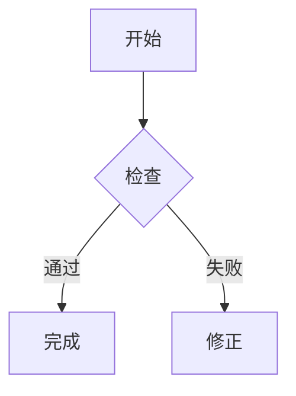

# Markdown 编辑指南：在 VS Code 中编写与预览

> **适用对象：** 初学 Markdown、使用 Visual Studio Code（VS Code）编写文档的读者。  
> **目标：** 学会常用 Markdown 语法，区分通用语法与平台扩展，并能在预览器中排查显示差异。  
> **示例约定：** 标注为 `markdown` 的代码块展示要输入的源码；“预览效果”展示渲染后的外观。

Markdown 有不同的语法规范和平台扩展。同一份 `.md` 文件在 VS Code、GitHub 和其他编辑器中不一定完全相同。尤其是 HTML/CSS、脚注、数学公式和 Mermaid，实际效果取决于预览器、扩展及平台设置。

## 在 VS Code 中打开预览

- **打开或关闭预览：** Windows/Linux 按 `Ctrl+Shift+V`；macOS 按 `Cmd+Shift+V`。
- **在侧边打开预览：** Windows/Linux 按 `Ctrl+K`，再按 `V`；macOS 按 `Cmd+K`，再按 `V`。这是先后按两个快捷键，不是同时按三个键。
- 也可以在命令面板（Windows/Linux：`Ctrl+Shift+P`；macOS：`Cmd+Shift+P`）搜索 **Markdown: Open Preview** 或 **Markdown: Open Preview to the Side**。
- 编辑并保存 `.md` 文件后，预览窗格通常会自动更新。
- 如果快捷键不起作用，确认当前编辑器打开的是 Markdown 文件，并检查 **Keyboard Shortcuts** 中是否存在快捷键冲突。

### 推荐的编写与检查顺序

1. 先在 Markdown 源文件中写结构和内容。
2. 打开侧边预览，确认标题层级、列表缩进、链接和代码块。
3. 对需要发布的文档，再到目标平台（例如 GitHub 页面）检查一次；VS Code 预览不保证目标平台支持所有扩展。

## 目录

- [标题与段落](#标题与段落)
- [强调与转义](#强调与转义)
- [链接](#链接)
- [图片](#图片)
- [列表](#列表)
- [引用块](#引用块)
- [代码](#代码)
- [分隔线](#分隔线)
- [表格](#表格)
- [脚注、上下标与文字标记](#脚注上下标与文字标记)
- [HTML 与颜色](#html-与颜色)
- [数学公式](#数学公式)
- [Mermaid 图表](#mermaid-图表)
- [其他扩展](#其他扩展)
- [常见预览问题](#常见预览问题)
- [兼容性建议](#兼容性建议)
- [可复用的文档骨架](#可复用的文档骨架)
- [规范、标准与兼容性](#规范标准与兼容性)

## 标题与段落

推荐使用 ATX 标题：在行首输入 1 至 6 个 `#`，井号后至少留一个空格。标题级别应按层级使用，不要为了改变字号跳过级别；通常一篇文档只设一个一级标题：

```markdown
# 一级标题
## 二级标题
### 三级标题
#### 四级标题
##### 五级标题
###### 六级标题
```

也可用 Setext 写法创建一级和二级标题：

```markdown
一级标题
========

二级标题
--------
```

空一行表示新段落。Markdown 源码中的单个换行通常会显示为同一段中的空格。若确实需要段内换行，可在行尾加两个空格或反斜杠；一般优先拆成段落，避免依赖不易看见的行尾空格。

```markdown
第一段。

第二段第一行。  
第二段第二行。
```

### 预览效果

> # 一级标题
>
> ## 二级标题
>
> ### 三级标题
>
> #### 四级标题
>
> ##### 五级标题
>
> ###### 六级标题

> 一级 Setext 标题
> ================
>
> 二级 Setext 标题
> ----------------

第一段文字。普通源文件换行通常会并入同一段。

第二段第一行。  
第二段第二行显示在新的一行。

## 强调与转义

使用一对 `*` 或 `_` 表示斜体，使用两对表示粗体；使用 `\` 可转义 Markdown 特殊字符。为了让中文预览器和不同 Markdown 渲染器都能稳定识别，**加粗标记 `**` 的前后建议留空格或标点分隔**，尤其避免结束的 `**` 紧贴后续中文或英文：

```markdown
这是 *斜体*、**粗体**、***粗斜体*** 和 ~~删除线~~ 的示例。

显示字面星号：\*这里的星号不会触发斜体\*。
```

### 预览效果

这是 *斜体*、**粗体**、***粗斜体*** 和 ~~删除线~~ 的示例。

显示字面星号：\*这里的星号不会触发斜体\*。

删除线属于 GitHub Flavored Markdown（GFM）等扩展，不属于 CommonMark 核心语法。

## 链接

```markdown
[VS Code](https://code.visualstudio.com/)
[带提示文字](https://example.com "鼠标悬停提示")
<https://example.com>
<name@example.com>
[发送邮件](mailto:name@example.com)
```

引用式链接适合重复引用长网址：

```markdown
[CommonMark][cm]
[cm]: https://commonmark.org/ "CommonMark 官网"
```

### 预览效果

基础链接：打开 [VS Code 官网](https://code.visualstudio.com/) 或 [CommonMark 官网](https://commonmark.org/)。

引用式链接：[CommonMark][cm]

[cm]: https://commonmark.org/ "CommonMark 官网"

[带提示文字](https://example.com "鼠标悬停提示")　<https://example.com>　<name@example.com>　[发送邮件](mailto:name@example.com)

上面分别显示为可点击链接、网址自动链接、邮箱自动链接和邮件链接；鼠标悬停提示需要预览器支持。

## 图片

Markdown 图片语法与链接类似，只是在方括号前加 `!`。方括号中的替代文字（alt text）用于辅助技术阅读，也会在图片无法加载时显示。

```markdown


```

引用式图片：

```markdown
![系统示意图][diagram]
[diagram]: ./images/diagram.png "系统示意图"
```

替代文字可供屏幕阅读器使用，也会在图片无法加载时显示。路径通常相对于当前 `.md` 文件。Markdown 没有标准的图片尺寸和对齐语法；支持 HTML 时可以写：

```html

```

### 预览效果


上图来自在线占位图服务，需要联网；实际文档建议使用仓库中的本地图片，或稳定且有权使用的图片地址。

## 列表

无序列表可用 `-`、`*` 或 `+`；有序列表用数字加句点。建议同一列表始终使用同一种标记，并在列表项之间保持一致的空行风格：

```markdown
- 苹果
- 香蕉
  - 青香蕉

1. 第一步
2. 第二步
```

GFM（GitHub Flavored Markdown）任务列表：

```markdown
- [x] 已完成
- [ ] 待处理
```

### 预览效果

- 苹果
- 香蕉
  - 青香蕉

- [x] 已完成
- [ ] 待处理

1. 第一步
2. 第二步

## 引用块

在行首加 `>`；可嵌套，也可包含多段内容。引用块中也可以继续使用标题、列表或代码块：

```markdown
> 这是一段引用。
>
> 引用中的第二段。
>
> > 嵌套引用
```

### 预览效果

> 这是一段引用。
>
> 引用中的第二段。
>
> > 嵌套引用

## 代码

行内代码用反引号包围，适合命令、文件名、变量名等短内容。反引号内的 Markdown 标记不会被解析：

```markdown
运行 `npm install`，编辑 `README.md`。
```

围栏代码块由三反引号或更多反引号构成；在开始围栏后写语言标识符，可启用语法高亮：

````markdown
```javascript
const message = "Hello, Markdown!";
console.log(message);
```
````

三个波浪号也可用作围栏。代码里若已有三反引号，外层围栏改用四个或更多反引号。缩进 4 个空格也可表示代码块，但围栏形式更清晰。务必使用相同数量的反引号关闭代码块；围栏未关闭时，后续内容可能都被当成代码。

### 预览效果

运行 `npm install`，编辑 `README.md`。

```javascript
const message = "Hello, Markdown!";
console.log(message);
```

## 分隔线

单独一行写至少三个 `-`、`*` 或 `_`，前后留空行：

```markdown
---
***
___
```

### 预览效果

上方内容。

---

下方内容。

三种符号的显示效果相同：

连字符：

---

星号：

***

下划线：

___

## 表格

表格是 GFM 扩展。用 `|` 分隔列，第二行定义表头；冒号控制对齐：

```markdown
| 左对齐 | 居中 | 右对齐 |
| :--- | :---: | ---: |
| 电压 | 输入 | 5 V |
| 电流 | 输出 | 2 A |
```

### 预览效果

| 左对齐 | 居中 | 右对齐 |
| :--- | :---: | ---: |
| 电压 | 输入 | 5 V |
| 电流 | 输出 | 2 A |

单元格中的字面竖线写作 `\|`。合并单元格没有统一的 Markdown 写法。

## 脚注、上下标与文字标记

脚注需要特定平台或扩展支持。正文使用 `[^标识符]` 引用脚注，定义单独放在一行；标识符在文档中应唯一：

```markdown
这里有脚注。[^note]

[^note]: 脚注内容。
```

上标、下标、高亮可使用 HTML：

```html
m<sup>2</sup>
H<sub>2</sub>O
<mark>高亮文字</mark>
```

### 预览效果

单位 m<sup>2</sup>；化学式 H<sub>2</sub>O；<mark>高亮文字</mark>。

这里有一条脚注。[^shown-note]

[^shown-note]: 这是脚注实际显示的说明文字。是否生成脚注区取决于预览器或扩展。

## HTML 与颜色

Markdown 不是 CSS 排版语言。CommonMark 允许原始 HTML，但预览器或网站可能过滤标签、属性和样式。不要用 HTML/CSS 承载必须保留的信息，也不要嵌入脚本或不可信的 HTML。

### 用语义颜色突出重点

颜色适合标记信息类型，不宜装饰每一段文字。下面这组低饱和颜色可用于提示、完成状态、注意事项和风险；先写清楚文字含义，再用颜色辅助识别。GitHub 可能移除行内 `style`，所以颜色消失后文字仍应完整可读。

```html
<span style="color: #2563eb;"><strong>提示：</strong></span>先检查当前分支。
<span style="color: #0f766e;"><strong>完成：</strong></span>改动已提交并推送。
<span style="color: #a16207;"><strong>注意：</strong></span>执行前先检查目标路径。
<span style="color: #b91c1c;"><strong>风险：</strong></span>此操作可能丢失未提交内容。
```

### 预览效果

<span style="color: #2563eb;"><strong>提示：</strong></span>先检查当前分支。  
<span style="color: #0f766e;"><strong>完成：</strong></span>改动已提交并推送。  
<span style="color: #a16207;"><strong>注意：</strong></span>执行前先检查目标路径。  
<span style="color: #b91c1c;"><strong>风险：</strong></span>此操作可能丢失未提交内容。

若目标是 GitHub，可优先用其支持的提示块表达重要程度；它们比自定义行内颜色更稳定：

```markdown
> [!WARNING]
> `git reset --hard` 可能丢弃未提交的工作。
```

配色还应考虑明暗主题与对比度；不要只用红、绿区分结果，始终保留“成功”“失败”等文字标签。

```html
<span style="color: red;">红色文字</span>
<span style="color: deeppink;">深粉色文字</span>
<span style="color: #007acc;">十六进制蓝色</span>
<span style="background-color: yellow;">黄色背景</span>
<span style="font-size: 20px;">较大文字</span>
<div style="text-align: center;">居中文字</div>
```

### 预览效果

普通文字、<span style="color: deeppink;">深粉色文字</span>、<span style="color: #007acc;">蓝色文字</span>、<span style="background-color: yellow;">黄色背景</span>。

<span style="color: red;">红色文字</span>　<span style="font-size: 20px;">较大文字</span>

<div style="text-align: center;">居中文字</div>

颜色效果取决于预览器是否允许内联 CSS。旧式 `<font color="red">` 已过时，不建议使用。

换行标签：第一行<br>第二行

实际 HTML 标签显示：<u>下划线</u>、<del>删除文字</del>、<ins>插入文字</ins>、<kbd>Ctrl</kbd> + <kbd>S</kbd>。

<details>
  <summary>点击展开</summary>
  展开后显示这段折叠内容。
</details>

常见 HTML 标签还包括 `<u>` 下划线、`<del>` 删除、`<ins>` 插入、`<kbd>` 按键、`<br>` 换行，以及 `<details><summary>` 折叠内容。它们都不是 Markdown 核心语法。

## 数学公式

数学公式使用 LaTeX 风格语法，需渲染器或扩展支持：

```text
行内：$E = mc^2$

独立公式：
$$
\int_0^1 x^2\,dx = \frac{1}{3}
$$
```

### 预览效果

行内：$E = mc^2$

$$
\int_0^1 x^2\,dx = \frac{1}{3}
$$

若预览仍显示美元符号和反斜杠，说明当前预览没有启用数学公式支持。

## Mermaid 图表

支持 Mermaid 的预览器会渲染以下代码块；VS Code 版本、设置或扩展可能影响显示：

````markdown

````

### 预览效果


上述源码示例的对应图表：


## 其他扩展

### YAML Front Matter

由静态网站生成器或笔记工具读取，不属于 Markdown 核心：

```yaml
---
title: 文档标题
tags:
  - Markdown
---
```

### 预览效果

Front Matter 是供静态网站或笔记工具读取的元数据，不是正文格式。构建工具可能据此设置页面标题和标签；VS Code 或其他预览器中是否隐藏它取决于工具。

### GitHub 提示块

属于 GitHub 扩展，其他渲染器可能只显示普通引用：

```markdown
> [!NOTE]
> 这是提示内容。
```

### 预览效果（GitHub）

> [!NOTE]
> 这是提示内容。

GitHub 可将其显示为带样式的提示框；不支持 GFM 提示块的预览器通常只显示普通引用块。

### 折叠块

支持 HTML 的渲染器可显示折叠区域：

```html
<details>
  <summary>点击展开</summary>
  折叠内容。
</details>
```

其他常见扩展包括 Emoji 短代码（如 `:smile:`）和脚注；它们的写法与支持情况因平台而异。

### 预览效果

<details>
  <summary>点击展开</summary>
  折叠内容。
</details>

Emoji 短代码的显示结果也因平台而异：支持短代码的平台可能把 `:smile:` 显示为 😄，否则会保留原文。

## 常见预览问题

| 现象 | 常见原因 | 检查方法 |
|---|---|---|
| 预览里出现字面的 `**` 或 `*` | 强调标记没有成对；结束标记紧贴后续文字；标记中间包含换行 | 检查每组标记是否成对，并在结束的 `**` 后留空格或标点，再重新打开预览 |
| 后续整段都显示成代码 | 围栏代码块少了结束反引号，或开始与结束围栏数量不同 | 找到对应代码块，确认结束围栏单独占一行且反引号数量相同 |
| 列表或引用缩进错乱 | 缩进层级不一致；列表前后缺少空行；代码围栏未关闭 | 统一缩进，检查列表结构和前面的围栏 |
| 图片不显示 | 文件路径错误、大小写不一致、网络不可用，或平台不允许该图片地址 | 优先使用相对于 Markdown 文件的正确路径；检查文件存在性和网络连接 |
| 表格显示成普通文字 | 当前预览器不支持 GFM 表格，或分隔行格式不正确 | 确认表头下方有 `| --- |` 形式的分隔行；在支持 GFM 的预览器中查看 |
| 脚注、公式、颜色或 Mermaid 不渲染 | 功能不属于 CommonMark 核心，当前工具可能不支持或未启用 | 查看目标工具的 Markdown 扩展说明；需要跨平台时改用兼容性更好的写法 |
| 链接文字可见但无法跳转 | URL 中含空格或括号，或目标地址写错 | 检查目标 URL；复杂 URL 可用尖括号括起或对特殊字符编码 |

## 兼容性建议

- VS Code 预览快捷键：Windows/Linux 使用 `Ctrl+Shift+V`；macOS 使用 `Cmd+Shift+V`。侧边预览分别是 `Ctrl+K` 后按 `V`、`Cmd+K` 后按 `V`。
- 图片不显示时，检查相对路径、文件名大小写以及网络连接。
- 颜色、公式、Mermaid、表格、任务列表和脚注都可能依赖渲染器或扩展。
- 若文档需要跨平台发布，优先使用标题、段落、强调、链接、图片、列表、引用和代码等 CommonMark 核心语法。
- 需要 HTML 时，将其视为渐进增强；不要把关键信息只放在可能被过滤的颜色、样式或折叠内容中。
- 保存后在目标平台检查预览；VS Code 中能显示，不保证其他平台也允许相同的 HTML/CSS。

## 可复用的文档骨架

````markdown
# 文档标题

> 一句话说明文档用途或适用对象。

## 概述

说明文档解决什么问题、读者需要准备什么。

## 操作步骤

1. 第一步。
2. 第二步。

## 示例

```text
在此放置示例内容。
```

## 常见问题

| 问题 | 解决方法 |
|---|---|
| 示例问题 | 示例解决办法 |
````

外层使用四个反引号，才能在示例中完整展示内层的三个反引号围栏。

## 规范、标准与兼容性

严格来说，Markdown **没有由 ISO/IEC 发布、所有平台共同遵循的统一国际语法标准**。早期 Markdown 实现曾存在差异。CommonMark 是公开维护且定义严格的 Markdown 规范；GitHub Flavored Markdown（GFM）以 CommonMark 为基础增加扩展。因此，跨平台写作时应区分规范核心和工具扩展，不要把某个编辑器支持的功能误当成所有 Markdown 都支持。

| 范围 | 常见语法 | 说明 |
|---|---|---|
| CommonMark 核心 | 段落、ATX/Setext 标题、强调、行内代码、围栏代码块、引用、列表、链接、图片、分隔线、转义 | 适合跨平台使用；不同渲染器仍可能出于安全考虑过滤原始 HTML |
| GFM 扩展 | 表格、删除线、任务列表 | GitHub 支持；其他预览器不一定支持 |
| 平台或工具扩展 | 脚注、提示块、Emoji 短代码、数学公式、Mermaid、YAML Front Matter | 写作前应确认目标平台或扩展的支持情况 |
| HTML/CSS | 颜色、字号、上下标、折叠区域等 | 显示可能被过滤或受样式限制，不宜承载关键内容 |

规范参考：

- [CommonMark 规范](https://spec.commonmark.org/)
- [GitHub Flavored Markdown 规范](https://github.github.com/gfm/)
- [VS Code Markdown 文档](https://code.visualstudio.com/docs/languages/markdown)